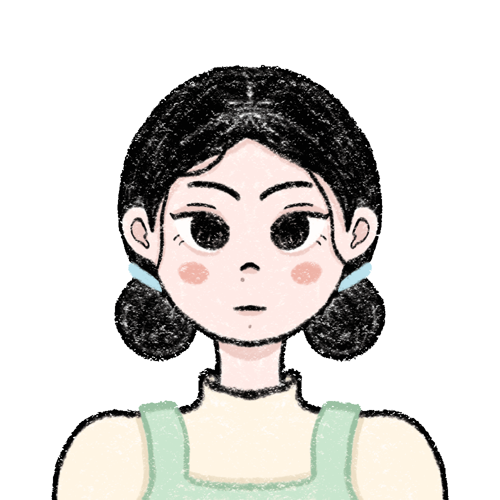

  

  

  

<h2>$\color{#78ad58}{\mathbf{\text{ 🌱 About Me }}}$</h2>

I'm a **BSIT student** passionate about creating **clean, modern, and interactive web experiences**.  
I love building projects that are responsive, playful, and visually soft on the eyes.

 

  <table style="background-color: #FDFDFF; border-collapse: collapse;">
    <tr>
      <td align="center" width="160" style="padding: 20px; border: 2px solid #86B6F6; border-right: none;">
        
      </td>
      <td align="left" style="padding: 20px; border: 2px solid #86B6F6; border-left: none;">
        <h3 style="color: #86B6F6; margin: 0 0 5px 0;">Cha Guray</h3>
        
<b>Aspiring Frontend Developer</b>

        
Philippines | BSIT Student

        
      </td>
    </tr>
  </table>

 

## ☁️ Tech & Tools

  

 

  
  
  
  
  
  
  
   
  
  
  
  
  

  

## Activity & Achievements

<!-- Profile Details Card -->

  

<!-- Top Languages Card -->

  
  

<!-- Commit Stats & Productive Time Cards -->

  
  

---

## 🔗 Let's Connect!

  
  
  

  

  
  🍥 • ᴗ • 🍥
  

